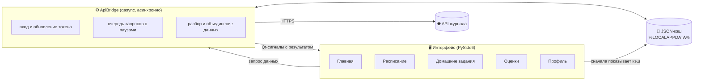
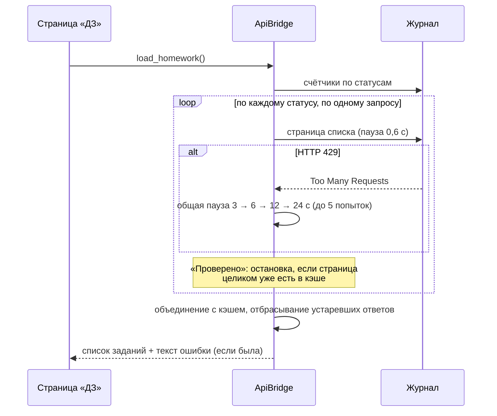

<div align="center">

# 🎓 StudentHub

**Неофициальный настольный клиент электронного журнала TOP Academy**<br>
Расписание · домашние задания · оценки · рейтинг группы · профиль — в одном окне


-41CD52?logo=qt&logoColor=white)


</div>

> [!IMPORTANT]
> Проект **не связан с TOP Academy / IT Step** и не одобрен ими. Приложение работает под *вашей* учётной записью через публичный API журнала. Используйте на свой риск и в рамках правил вашего учебного заведения. Все названия и товарные знаки принадлежат их владельцам.

<!--
📸 СКРИНШОТЫ (по желанию): положите картинки в docs/screenshots/ и раскомментируйте блок.

<div align="center">


</div>
-->

## 📖 Содержание

- [Что это](#-что-это)
- [Возможности](#-возможности)
- [Как это работает](#-как-это-работает)
- [Установка и запуск](#-установка-и-запуск)
- [Сборка EXE и установщика](#-сборка-exe-и-установщика)
- [Данные и приватность](#-данные-и-приватность)
- [Настройка](#️-настройка)
- [Структура проекта](#-структура-проекта)
- [FAQ и решение проблем](#-faq-и-решение-проблем)
- [Идеи для развития](#️-идеи-для-развития)
- [Вклад в проект](#-вклад-в-проект)
- [Лицензия](#️-лицензия-и-дисклеймер)
- [English](#-english-summary)

## 💡 Что это

Веб-версия журнала неудобна, когда нужно быстро понять: *что сдать, что просрочено, какой средний балл и на каком я месте в группе*. **StudentHub** собирает всё это в одном компактном окне: заходите своим логином от журнала — и видите расписание, задания карточками, оценки и рейтинг. Данные кэшируются на диске, поэтому приложение открывается мгновенно и показывает последнюю картину, даже если журнал временно недоступен.

## ✨ Возможности

| Раздел | Что умеет |
|---|---|
| 🏠 **Главная** | Ближайшие пары на сегодня и сводка по учёбе |
| 📅 **Расписание** | Расписание из журнала (API) и локальные группы; недельная сетка |
| 📚 **Домашние задания** | Карточки в адаптивной сетке (1–3 колонки), плитки-фильтры, поиск, фильтр по предмету, счётчики |
| 📤 **Сдача работы** | Загрузка файла, комментарий, затраченное время, удаление черновика |
| 📎 **Файлы и фото** | Файл задания с автоопределением типа, фото преподавателя в карточке (клик — на весь экран), комментарий преподавателя |
| 🏆 **Оценки** | Кольцо среднего балла, распределение 5/4/3/ниже, последние оценки, фильтры по периоду и предмету |
| 🥇 **Рейтинг группы** | Место в группе, таблица рейтинга (ваша строка подсвечена), посещаемость |
| 👤 **Профиль** | Данные студента, быстрые переходы, статистика |
| 📊 **Журнал** | Сводка по ДЗ и средний балл |
| 🎨 **Интерфейс** | Тёмная и светлая тема, русский и английский язык |
| 🛟 **Надёжность** | Кэш на диске, аккуратная работа с лимитами API (HTTP 429), журнал ошибок |

## 🧠 Как это работает

### Общая схема



**Основные идеи**

1. **Интерфейс не блокируется.** Сетевая часть собрана в одном классе `ApiBridge`. Он работает на цикле событий `qasync` (asyncio поверх Qt) и возвращает результат страницам через Qt-сигналы (`homework_loaded`, `grades_loaded`, `profile_loaded` и др.).
2. **Сначала кэш, потом сеть.** Любая страница сразу рисует то, что сохранено в JSON, и только потом обновляется. Если запрос частично не удался, недостающее берётся из кэша, а в углу страницы показывается причина.
3. **Вход без хранения пароля.** Пароль используется один раз для входа. Дальше хранится только refresh-токен, а при истечении доступа приложение само обновляет его и повторяет запрос.

### Как загружаются домашние задания



Что здесь важно:

- **Запросы идут по одному** с паузой, а после первого ответа 429 пауза действует сразу на все запросы. Журнал ограничивает частоту, и «пачка» запросов приводила к блокировке.
- **Проверенные работы не листаются целиком.** Они не меняются, поэтому загрузка этого списка останавливается на первой странице, которая уже полностью известна из кэша. Первая загрузка полная и поэтому самая долгая.
- **Устаревшие ответы отбрасываются.** Если одновременно запущено несколько загрузок (кнопка «Обновить», сдача работы), принимается только результат самой новой. Иначе медленный старый ответ мог «вернуть» уже удалённый черновик.

### Как определяется состояние задания

| Состояние | Условие |
|---|---|
| 🟢 **Проверено** | есть оценка больше 0 (или журнал пометил работу проверенной) |
| 🟡 **На проверке** | работа сдана, оценки ещё нет |
| 🔴 **Просрочено** | срок прошёл, работы нет |
| 🔵 **К выполнению** | срок не прошёл, работы нет |

Оценка `0` или пустая считается «нет оценки» и в средний балл не входит.

### Файлы, фото и «странные» форматы

- **Скачивание файла задания.** Приложение само скачивает файл и определяет *настоящий* тип по первым байтам (pdf, docx, xlsx, pptx, doc, xls, ppt, zip, rar, 7z, png, jpg, gif). Если расширение в имени не совпало с содержимым (например, docx пришёл как `.rtf`), оно исправляется. После сохранения файл открывается.
- **Фото преподавателя.** Картинкой считается файл задания с расширением png/jpg/jpeg/gif/webp/bmp, а также тег `` в описании или комментарии (в том числе `data:`-ссылки). Миниатюра подгружается асинхронно и кэшируется на время сессии.
- **RTF и HTML в текстах.** Если описание или комментарий пришли в формате RTF, они преобразуются в обычный текст (включая кириллицу), а HTML-теги и сущности убираются.

### Оценки и семестры

- Средний балл считается по проверенным ДЗ (оценка больше 0).
- Фильтр «Текущий семестр»: 1-й семестр — с 1 сентября по 31 января, 2-й — с 1 февраля по 31 августа.
- Цвет оценки: 5 — зелёный, 4 — синий, 3 — оранжевый, ниже — красный.

### Адаптивная сетка карточек

Число колонок считается по ширине окна: минимальная ширина карточки 460 px, максимум 3 колонки. Длинные темы переносятся внутри карточки и не раздувают сетку. Константы `HW_CARD_MIN_W` и `HW_MAX_COLS` находятся в начале блока «Домашние задания».

## 🚀 Установка и запуск

Нужны **Windows** и **Python 3.11–3.14**. Из исходников приложение может запускаться и на других системах (PySide6 кроссплатформенный), но сборка рассчитана на Windows.

```bash
git clone https://github.com/T1xnik/Journal-Universel-Versual.git
cd Journal-Universel-Versual/StudentHub

python -m venv .venv
.venv\Scripts\activate          # Windows
# source .venv/bin/activate     # Linux / macOS

pip install -r requirements.txt
python StudentHub.pyw
```

При первом запуске войдите логином и паролем от журнала.

## 📦 Сборка EXE и установщика

| Скрипт | Результат |
|---|---|
| `build_app.bat` | папка `dist\StudentHub\` с `StudentHub.exe` |
| `build_onefile.bat` | один файл `dist\StudentHub-OneFile.exe` |
| `build_installer.bat` | установщик `installer_output\StudentHub-Setup-<версия>.exe` |

Скрипты лежат в папке `StudentHub` и запускаются оттуда. Они сами находят Python, ставят зависимости и запускают PyInstaller. Установщик собирается в [Inno Setup 6](https://jrsoftware.org/isinfo.php) (если его нет, скрипт попробует поставить его через `winget`).

**Установщик умеет:** русский и английский язык; установку для текущего пользователя без прав администратора; ярлыки в меню «Пуск» и на рабочем столе; запись в «Установка и удаление программ»; сохранение пользовательских данных при удалении.

## 🔐 Данные и приватность

- 🔑 **Пароль не сохраняется.** Хранится только refresh-токен журнала.
- 📁 Все данные лежат локально в `%LOCALAPPDATA%\StudentHub\`:

  | Файл | Что внутри |
  |---|---|
  | `auth.json` | токены входа (**в открытом виде** — никому не передавайте и не публикуйте) |
  | `profile.json` | данные профиля |
  | `homework_cache.json` | кэш домашних заданий |
  | `grades_cache.json` | кэш оценок и рейтинга |
  | `schedule_cache.json` | кэш расписания |
  | `settings.json` | тема и язык |
  | `last_error.log` | технический журнал ошибок |

- 🌐 Приложение обращается только к API журнала и к его файловому хранилищу (файлы и фото заданий). Своих серверов и телеметрии нет.
- 🧾 В `last_error.log` попадают адреса запросов и тексты ошибок. Перед тем как прикладывать лог к issue, просмотрите его на личные данные.
- 🧪 Расписание в исходниках — **вымышленный пример**. Реальное подгружается из журнала.

## ⚙️ Настройка

| Что | Как |
|---|---|
| Тема и язык | раздел «Настройки» (применяются после перезапуска) |
| Ссылка «Поддержка автора» | переменная окружения `STUDENTHUB_DONATE_URL`; если не задана, раздел скрыт |
| Свои локальные группы | `SCHEDULE_MINE` и `GROUPS_JSON` в `StudentHub.pyw` (5 дней × 5 пар, пара = `[предмет, аудитория, преподаватель]`) |
| Папка с данными | `%LOCALAPPDATA%\StudentHub` (на других ОС — домашняя папка пользователя) |

## 🗂 Структура проекта

```text
Journal-Universel-Versual/
├── README.md                     # описание проекта
├── LICENSE                       # MIT
├── .gitignore
├── .gitattributes
└── StudentHub/                   # всё приложение здесь
    ├── StudentHub.pyw            # всё приложение (PySide6 + qasync)
    ├── StudentHub.ico            # иконка
    ├── requirements.txt          # зависимости
    ├── vendor/                   # неофициальный SDK журнала (MIT)
    ├── build_app.bat             # сборка папки с EXE (PyInstaller)
    ├── build_onefile.bat         # сборка одного EXE
    ├── build_installer.bat       # EXE + установщик
    ├── StudentHub.spec           # спецификации PyInstaller
    ├── StudentHub-OneFile.spec
    ├── StudentHub-Setup.iss      # скрипт Inno Setup
    └── THIRD_PARTY_NOTICES.md    # лицензии сторонних компонентов
```

**Внутри `StudentHub.pyw` (сверху вниз):**

1. настройки, пути и кэши, тексты интерфейса (RU/EN);
2. стили (`build_style`) и иконки, нарисованные кодом;
3. **`ApiBridge`** — вход, расписание, ДЗ, оценки, профиль, обратная связь;
4. диалоги (сдача работы, комментарий, фото);
5. страницы: расписание, домашние задания, журнал, оценки, профиль, поддержка, настройки, главная;
6. **`MainWindow`** — боковая навигация, стек страниц, обработчики сигналов; `main()` — запуск.

## ❓ FAQ и решение проблем

<details>
<summary><b>«Журнал ограничил частоту запросов» / HTTP 429</b></summary>

Журнал блокирует слишком частые запросы. Подождите минуту-две и нажмите «Обновить». Приложение уже ходит по одному запросу с паузами, но первая полная загрузка списка ДЗ всё равно может занять время. Пока загрузка идёт, показываются сохранённые данные.
</details>

<details>
<summary><b>Часть заданий не загрузилась, показаны сохранённые данные</b></summary>

Один или несколько запросов к журналу завершились ошибкой. Откройте `%LOCALAPPDATA%\StudentHub\last_error.log` и найдите строки `homework status=` — там указан код ошибки по каждому статусу.
</details>

<details>
<summary><b>Сборка падает с PermissionError [WinError 32]</b></summary>

Windows не даёт удалить папку `dist\StudentHub`, потому что её что-то использует. Закройте запущенный `StudentHub.exe`, окна Проводника в этой папке, подождите минуту (антивирус) и запустите сборку снова. Если проект лежит на рабочем столе с синхронизацией OneDrive, соберите его из простой папки, например `C:\StudentHub`.
</details>

<details>
<summary><b>Скачанный файл не открывается</b></summary>

Приложение определяет тип по содержимому и ставит правильное расширение. Если файл всё равно не открывается, возможно, на сервере лежит повреждённый файл или документ действительно в формате RTF. Приложите строку из `last_error.log` со словом `download`.
</details>

<details>
<summary><b>Не показывается фото преподавателя / комментарий</b></summary>

Фото показывается, если файл задания — картинка или в тексте есть ``. Комментарий отображается у сданных и проверенных работ; кнопка «Комментарий преподавателя» запрашивает полную карточку задания. В `last_error.log` записываются строки `hw-diag` (сколько заданий с комментариями, файлами, RTF) — они помогут разобраться.
</details>

<details>
<summary><b>Как добавить свои локальные группы расписания?</b></summary>

Отредактируйте `SCHEDULE_MINE` и `GROUPS_JSON` в `StudentHub.pyw`. Формат: 5 дней × 5 пар, каждая пара — `[предмет, аудитория, преподаватель]` или `null`.
</details>

## 🗺️ Идеи для развития

Это идеи, а не обещания:

- [ ] автоматические тесты для разбора ответов API
- [ ] CI (сборка EXE на GitHub Actions)
- [ ] выбор темы и языка без перезапуска
- [ ] уведомления о приближающихся сроках
- [ ] сборки для macOS и Linux

## 🤝 Вклад в проект

Issues и pull request'ы приветствуются. Если сообщаете об ошибке, укажите версию Python и Windows, что вы делали, и приложите фрагмент `last_error.log` (предварительно уберите личные данные).

## ⚖️ Лицензия и дисклеймер

Код распространяется по лицензии [MIT](LICENSE). Сторонние компоненты — см. [THIRD_PARTY_NOTICES.md](THIRD_PARTY_NOTICES.md). Проект неофициальный; автор не несёт ответственности за последствия использования, включая блокировку учётной записи со стороны сервиса.

---

## 🌍 English summary

**StudentHub** is an unofficial desktop client for the TOP Academy e-journal, built with PySide6. It brings your schedule, homework cards (submit work, task files, teacher photos and comments), grades with an average-score ring, group rating and profile into one window. Dark/light theme, Russian/English UI, local cache, rate-limit-aware API access (one request at a time, shared back-off on HTTP 429).

Your password is never stored; only a refresh token is saved locally in `%LOCALAPPDATA%\StudentHub`. There is no telemetry and no server of our own.

```bash
pip install -r requirements.txt
python StudentHub.pyw          # Python 3.11–3.14
```

Windows builds: `build_app.bat` (folder), `build_onefile.bat` (single EXE), `build_installer.bat` (installer via Inno Setup). MIT licensed. Not affiliated with TOP Academy / IT Step.
